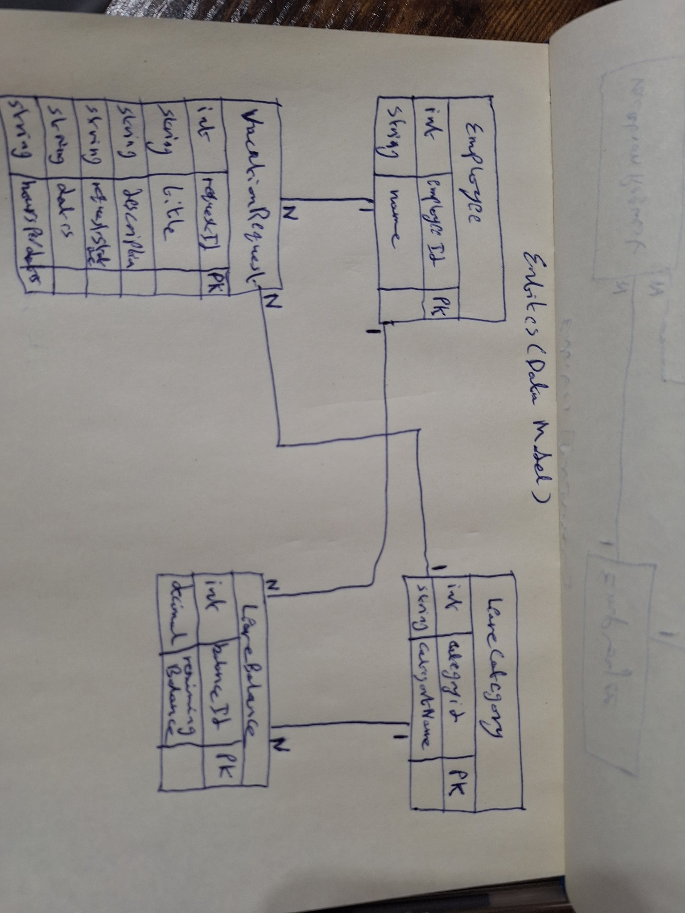
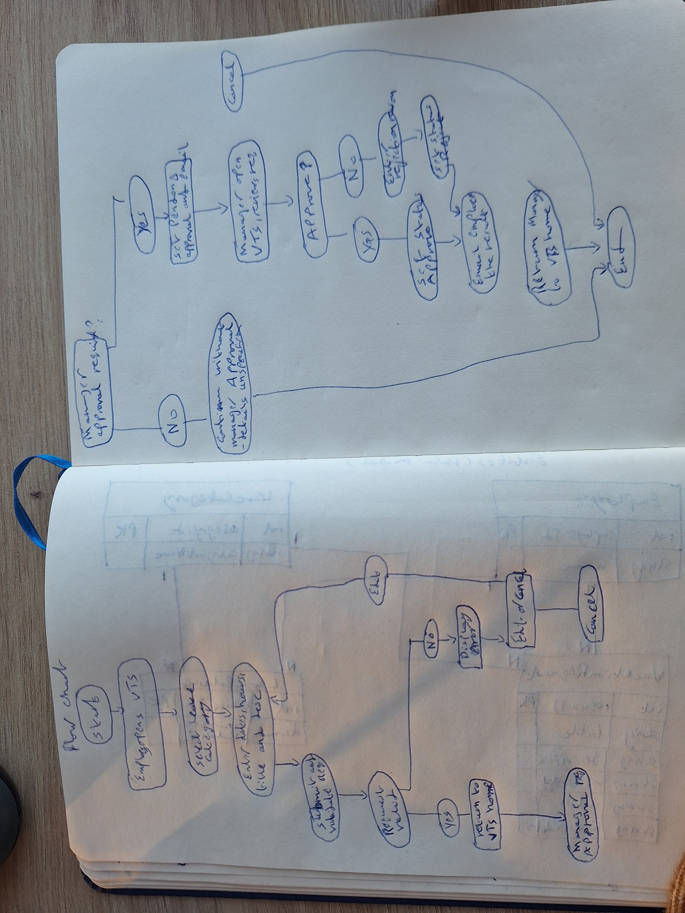
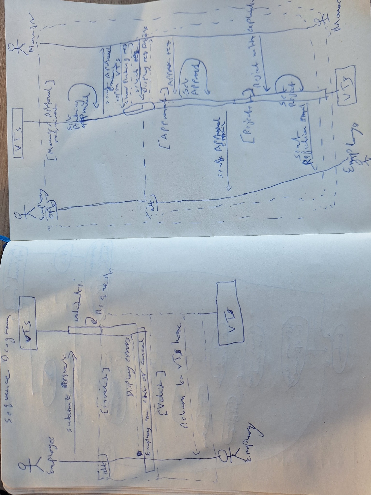
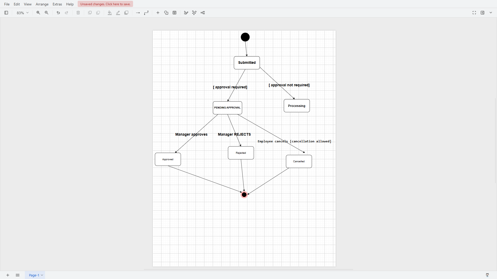
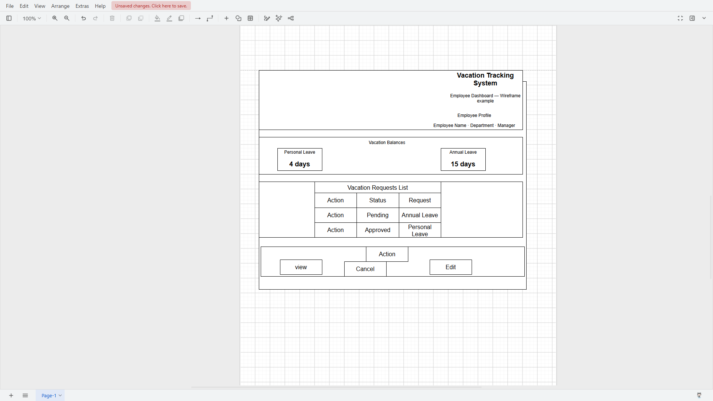

# Vacation Tracking System — Analysis & Design

Software engineering analysis and design practice for a Vacation Tracking System.

## 1. Vision

A Vacation Tracking System (VTS) aims to empower employees, improve vacation management, and reduce administrative workload.

 

## 2. Functional Requirements

- **FR-01:**: The system must validate and verify leave requests using rules.
- **FR-02:**: The system must support manager approval when required.
- **FR-03:**: The system must allow users to view vacation requests from the previous calendar year.
- **FR-04:**: The system must allow vacation requests up to 18 months in the future.
- **FR-05:**: The system must send emails to request manager approval and notify employees of status changes.
- **FR-06:**: The system must record activity logs for all transactions.
- **FR-07:**: The system must allow HR staff and system administrators to override actions blocked by rules and log these overrides.
- **FR-08:**: The system must allow managers to award personal leave time within system-set limits.
- **FR-09:**: The system must provide a web service for other internal systems to get employee vacation request summaries.
- **FR-10:**: The system must get required employee information and changes from existing HR systems.

## 3. Non-Functional Requirements

- **NFR-01 (Usability):** The system shall be easy to use and intuitive for employees.

## 4. Constraints

- **CON-01 (Existing Infrastructure):** The system shall use the existing hardware and middleware.
- **CON-02 (Intranet Portal):** The system shall be implemented as an extension to the existing intranet portal system.
- **CON-03 (Authentication):** The system shall use the existing intranet portal's Single Sign-On (SSO) mechanism for all authentication.

## 5. Domain — Define Problem

### 5.1 Business Problem

The vacation request process is slow because it involves multiple manual steps. Employees need an easier way to manage their vacation time without complicated procedures.

### 5.2 Domain Concepts

- Employee
- Manager
- Human Resources (HR)
- Vacation Request
- Leave Policy
- Vacation Balance

### 5.3 System Boundaries

**Inside the System:**
- Validate and verify leave requests using business rules.
- Send email notifications for manager approval and request status changes.
- Allow authorized HR staff and system administrators to override restricted actions and log these overrides.

**Outside the System:**
- Choosing vacation dates on behalf of employees. *(Inferred from the employee's responsibility to manage their own leave.)*

**External Systems:**
- Existing HR legacy systems used to retrieve employee information and updates.

## 6. Actors

### Employee
The employee uses the system to manage his or her vacation time.

### Manager
The manager has the same capabilities as an employee. The manager also approves vacation requests from direct subordinates and can award comp time within system-set limits.

### Clerk (HR)
The HR clerk views employee personal data, keeps employee information accurate and up to date across HR systems, and can add or remove most records in the VTS.

### System Admin
The system administrator manages the system's technical resources, such as the web server and database, and collects and archives log files.


## 7. Manage Time — Use Case Analysis

### 7.1 Entities (Data Model)



### 7.2 Flowchart



### 7.3 Sequence Diagram




### 7.4 Pseudocode
```text
BEGIN ManageTime


START

Employee opens VTS from the intranet portal
System displays vacation requests and balances

Employee selects a leave category
System displays the request form and calendar
Employee enters dates and hours

REPEAT
    Employee submits the request
    System validates the request

    IF request is invalid THEN
        Show validation errors

        IF employee chooses to cancel THEN
            END PROCESS
        ELSE
            Employee edits request details
        END IF
    END IF

UNTIL request is valid

IF manager approval is required THEN
    Set request status to Pending Approval
    Send approval email to manager

    Manager opens the request
    System displays request details

    IF manager approves THEN
        Set request status to Approved
        Send approval email to employee
    ELSE
        Manager enters rejection reason
        Set request status to Rejected
        Send rejection email to employee
    END IF

ELSE
    Continue processing without manager approval
END IF

Record transactions in activity logs

END
  

END ManageTime
```

## 8. Session 2 — Workflow & Use Case Design

### 8.1 Overview

This session focuses on request states, editing and cancelling vacation requests, user interface design, and a configurable approval workflow.

The diagrams below are analysis and design exercises based on the VTS case study.

### 8.2 Vacation Request State Machine

The State Machine Diagram represents the lifecycle of a vacation request, including pending approval, approval, rejection, and cancellation.



### 8.3 Cancel Approved Request

An employee can cancel an approved vacation request scheduled in the future or within the previous five business days.

For future requests, the employee confirms the cancellation. For recent-past requests, a short explanation is also required.

After successful cancellation, VTS changes the request status to Cancelled, restores the vacation balance, and notifies the manager. Aborting the cancellation leaves the request unchanged.

#### Flowchart


#### Sequence Diagram


### 8.4 Edit Pending Request

An employee can edit the title, comments, or dates of a request that is still pending approval.

If the changes are accepted, VTS returns to the home page. If errors are found, VTS redisplays the editing page and explains the problems.

The employee can also choose to withdraw the pending request. VTS asks for confirmation before withdrawing it.

#### Flowchart


#### Sequence Diagram


### 8.5 Employee UI Concept

The proposed employee dashboard includes a profile summary, vacation balances, a request list, request statuses, and actions such as View, Edit, and Cancel.

The interface should follow the existing intranet portal's design and user experience.



### 8.6 Database Changes Review

Editing a pending request updates its existing information after validation.

Cancelling an approved request changes its status to Cancelled and restores the used vacation balance.

Withdrawing a pending request requires confirmation. Its exact status and balance impact depend on the agreed business rules and database design.

No new database table is necessarily required for these operations alone.


### 8.7 Dynamic Workflow Design

The proposed data-driven workflow separates states, transitions, roles, and the current state of each vacation request.

- WORKFLOW_STATE stores possible states.
- WORKFLOW_TRANSITION defines allowed state changes, events, and required roles.
- ROLE stores user roles.
- VACATION_REQUEST stores the current state of each request.

This is a proposed design for supporting future approval stages, such as HR_PENDING, with minimal changes to the application logic.


### 8.8 Pseudocode — Current Workflow

The following is a simplified example of manager approval without an additional HR stage.

```text
BEGIN ApproveRequest

    READ current state of vacation request

    IF current state = PENDING THEN
        CHECK manager authorization

        IF manager is authorized THEN
            VALIDATE applicable business rules

            IF rules are valid THEN
                UPDATE request state TO APPROVED
            ELSE
                REJECT action
            END IF
        ELSE
            REJECT action
        END IF
    ELSE
        REJECT invalid transition
    END IF

END ApproveRequest
```

### 8.9 Pseudocode — Dynamic Workflow

This design reads allowed transitions from the database instead of hardcoding every destination state in Java.

```text
BEGIN ProcessRequest

    RECEIVE request_id, selected_event, current_user

    READ current_state_id
        FROM VACATION_REQUEST
        WHERE request_id = request_id

    FIND matching transition
        FROM WORKFLOW_TRANSITION
        WHERE from_state_id = current_state_id
          AND event_name = selected_event

    IF transition does not exist THEN
        REJECT action

    ELSE IF current_user does not have transition.required_role_id THEN
        REJECT unauthorized action

    ELSE
        VALIDATE applicable business rules

        IF validation fails THEN
            REJECT action
        ELSE
            UPDATE VACATION_REQUEST.current_state_id
                TO transition.to_state_id

            RECORD transaction in activity log
        END IF
    END IF

END ProcessRequest
```

### 8.10 Design Notes and Assumptions

- The HR approval stage is a future workflow scenario, not an existing mandatory step in the original VTS use case.
- WORKFLOW_STATE, WORKFLOW_TRANSITION, ROLE, and the current_state_id field represent a proposed configurable design.
- The application must enforce authorization, validation, and auditing regardless of workflow configuration.
- Changing request dates may require additional balance and overlap checks according to HR policies.
- The precise database handling of withdrawn pending requests requires clarification of the business rules.
- These diagrams and pseudocode describe an analysis/design proposal, not a completed software implementation.
